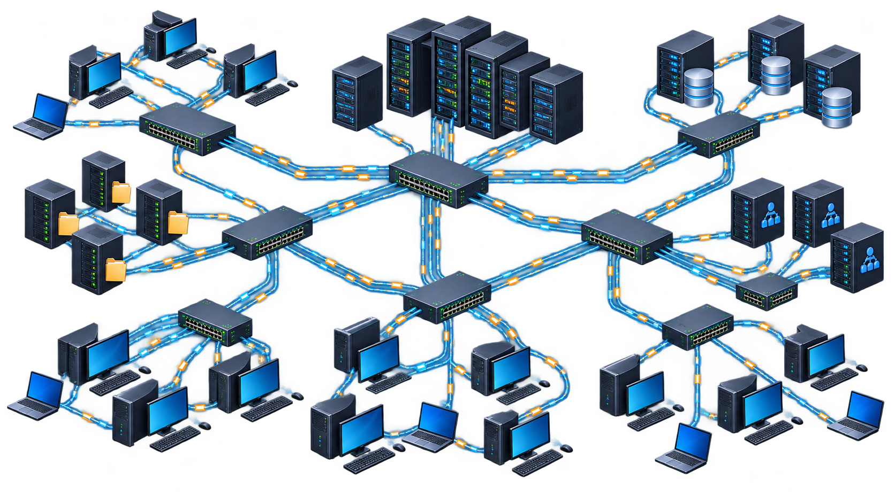

# About the Cyber Threat

## Introduction

This lab describes the threat that you investigate in this workshop and the data that records it. You do not run any steps in this lab.

Estimated Time: 5 minutes

### Objectives

In this lab, you will:

- Learn why an intruder with a valid account is hard to spot.
- Learn which sources record activity on the network.
- Learn what regular activity looks like, so you can spot activity that breaks the pattern.

## The Challenge

Imagine that you are responsible for network security in your company. Your managers want you to spot intruders: people who access systems they should not use.

Your network already records activity. A login record, for example, tells you which account accessed which computer, at what time, and whether the attempt succeeded.

*Finding a needle in the haystack*

The hard case is an intruder who uses a valid employee account. The login succeeds. The account then accesses another computer, and later a server. Each action alone can be legitimate. To decide, you need to see how the actions connect and whether the sequence fits the account. A graph makes these connections explicit.

## The Data

In this workshop, you investigate real network activity that Los Alamos National Laboratory (LANL) published in 2015. The data covers 58 consecutive days on the LANL internal corporate network. It also identifies compromise events from an authorized security exercise. These known events give you reference points to check your findings.

The records come from five sources:

| Source | Captured events | Details |
| --- | --- | --- |
| Windows desktops and servers | Authentication events | Account, computer, logon type, and outcome |
| Active Directory domain controllers | Domain authentication and Kerberos ticket events | Accounts, computers, method, and outcome |
| Windows desktops and servers | Process start and stop events | Process, computer, account, and time |
| Routers | Network flow records | Computers, ports, protocol, and traffic volume |
| DNS servers | DNS lookup events | Requesting computer, resolved computer, and time |

## What Regular Activity Looks Like

Consider a regular user who opens a file share. The user logs on at the workstation and gets Kerberos tickets from a domain controller. The workstation then resolves the file server name through DNS and opens an SMB session on TCP port 445. Four of the five sources record a trace of this activity.

As a graph, the activity connects a user, the workstation, a process, a domain controller, and the file server. Edges represent the logon, the ticket requests, the process start and end, the DNS lookup, and the network flows. The pattern looks regular for these reasons:

- The user works from their own workstation.
- Tickets come from a domain controller first.
- The DNS lookup, the network flow, and the logon happen in the expected order, seconds apart.
- The user accesses a small, stable set of servers, day after day.
- All four sources tell one consistent story about the same IDs.

The path of an intruder breaks patterns like these. In this workshop, you connect the records with Oracle Property Graph and explore them visually with Linkurious Ogma. You follow the trail and decide which activity needs a closer look.

## Learn More

- [LANL Comprehensive, Multi-Source Cyber-Security Events dataset](https://csr.lanl.gov/data/cyber1/)

## Acknowledgements

* **Author** - Karin Patenge, Database Product Management
* **Contributors** - Hans Viehmann, Léo Nicolle (Linkurious), Ramu Murakami Gutierrez
* **Last Updated By/Date** - Karin Patenge, December 2026
