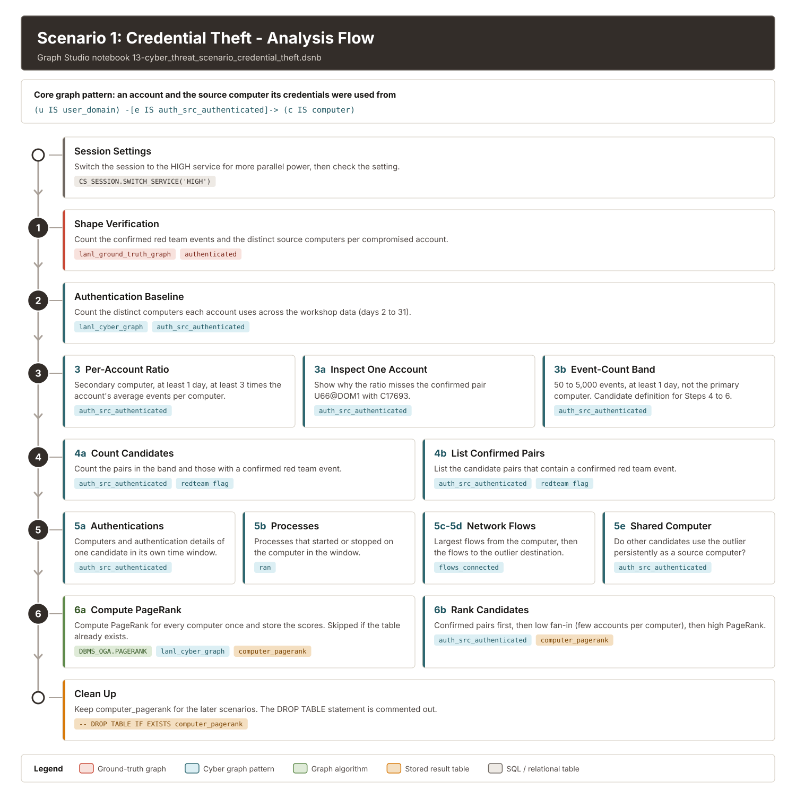
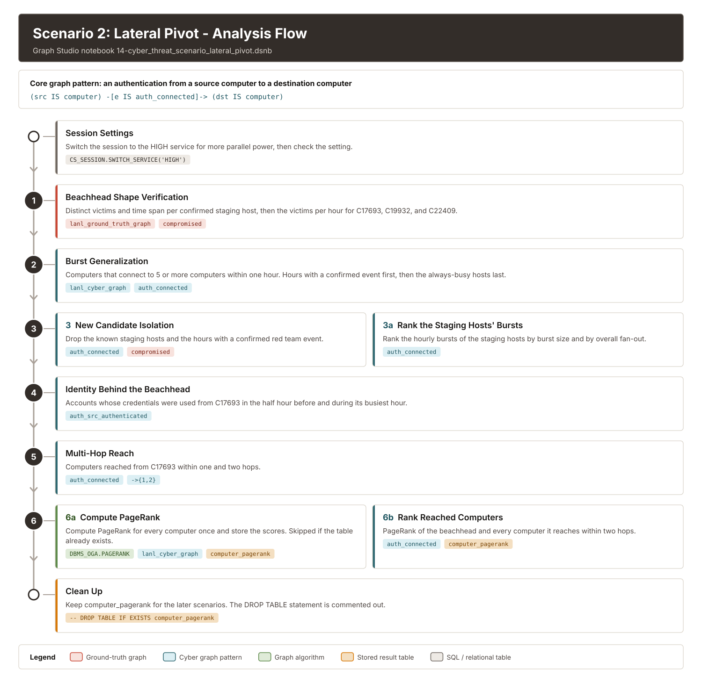
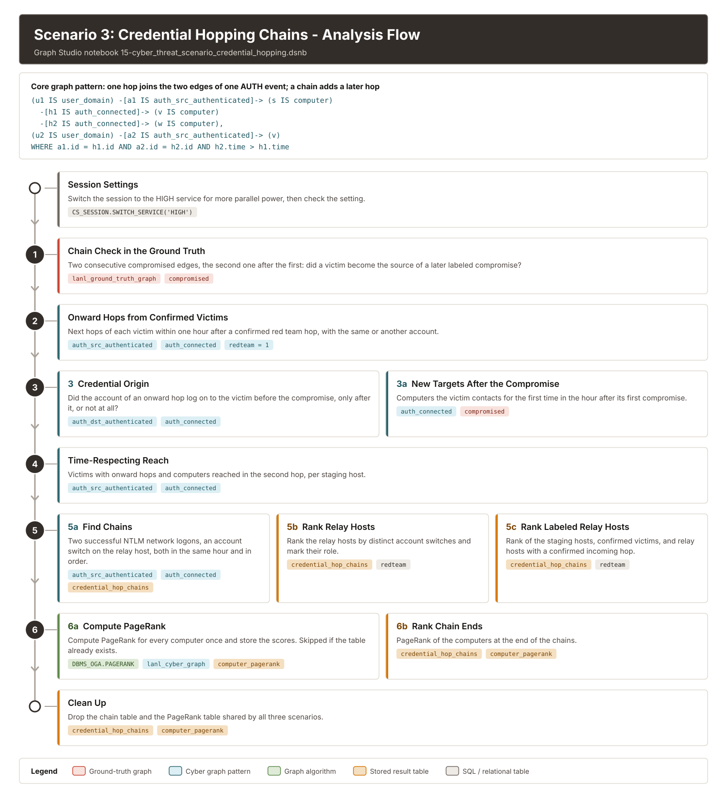
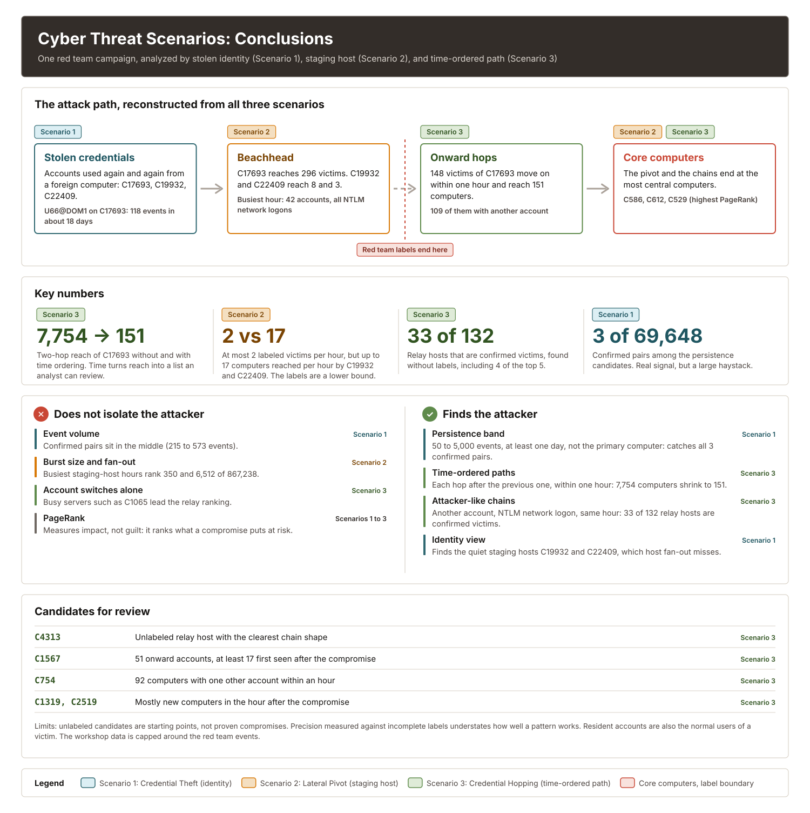

# Analyze the Cyber Threat Graphs

## Introduction

In this lab, you investigate one red team campaign in the LANL data with three Graph Studio notebooks. Each notebook covers one cyber threat scenario and looks at the campaign from a different angle:

| Scenario | Notebook | Question |
| --- | --- | --- |
| 1: Credential Theft | `13-cyber_threat_scenario_credential_theft.dsnb` | Whose credentials were stolen, and from which computer were they used? |
| 2: Lateral Pivot | `14-cyber_threat_scenario_lateral_pivot.dsnb` | Which computer did the attacker reuse as a beachhead, and how far did it reach? |
| 3: Credential Hopping | `15-cyber_threat_scenario_credential_hopping.dsnb` | Where did the attacker move next, hop after hop, and with which accounts? |

The notebooks combine two graph techniques:

- **Graph pattern matching.** SQL queries with the `GRAPH_TABLE` operator match paths in the property graphs from Lab 1. For example, the pattern `(u IS user_domain) -[e IS auth_src_authenticated]-> (c IS computer)` links each account to the computer that used its credentials.
- **Graph algorithms.** The `DBMS_OGA.PAGERANK` function computes how central each computer is in the network. The notebooks use the scores to judge the impact of a compromise.

Each notebook compares its results with the known compromise events in the ground-truth graph. That comparison shows how many known compromises a pattern catches and which unlabeled computers deserve a closer look.

Estimated Time: 60 minutes

### Objectives

In this lab, you will:

- Import three Graph Studio notebooks.
- Detect stolen credentials that someone uses again and again from a foreign computer.
- Trace a beachhead computer and its reach across the network.
- Follow time-ordered attack paths from one compromised computer to the next.
- Rank computers by their importance with PageRank.

### Prerequisites

This lab assumes you have:

- Completed Lab 1: Create the Cyber Threat Graphs. The notebooks query `LANL_CYBER_GRAPH` and `LANL_GROUND_TRUTH_GRAPH`.

> **Note:** Some queries run for several minutes. The longest one computes PageRank for every computer and takes about 18 minutes. Run the notebooks in the order 13, 14, 15: the first notebook stores the PageRank scores in a table, and the next two notebooks reuse it.

## Task 1: Download the Notebooks

1. Download the three notebook files to your computer:

    - [13-cyber\_threat\_scenario\_credential\_theft.dsnb](files/13-cyber_threat_scenario_credential_theft.dsnb?download=1)
    - [14-cyber\_threat\_scenario\_lateral\_pivot.dsnb](files/14-cyber_threat_scenario_lateral_pivot.dsnb?download=1)
    - [15-cyber\_threat\_scenario\_credential\_hopping.dsnb](files/15-cyber_threat_scenario_credential_hopping.dsnb?download=1)

    A `.dsnb` file is a Graph Studio notebook in its native file format.

## Task 2: Open Graph Studio

1. On your reservation page, click **View Login Info**. Copy the **Database Actions URL**, the database user `GRAPHUSER`, and its password.

2. Open the Database Actions URL in a new browser tab and sign in as `GRAPHUSER`. The Database Actions Launchpad opens.

3. Click the **Development** tab, and then click **Graph Studio**. If Graph Studio asks you to sign in, enter `GRAPHUSER` and its password again.

## Task 3: Import the Notebooks

1. In Graph Studio, open the **Notebooks** page from the navigation menu.

2. Click **Import** in the top right corner of the page. The **Import notebook(s)** window opens.

3. Drag the three `.dsnb` files into the **Drag and Drop** section, or click it and select the files.

4. Click **Import**. The **Notebooks** page lists the three notebooks: **Credential Theft**, **Lateral Pivot**, and **Credential Hopping**. Their names start with `LL/12172/`.

5. Open a notebook by clicking its name. When you open a notebook, Graph Studio attaches it to a compute environment. You can run the paragraphs as soon as the attachment is complete.

## Task 4: Detect Credential Theft

A legitimate account's credentials are stolen or shared. Someone then uses them again and again from a computer outside the account's normal routine, often for days or weeks. This notebook searches the authentication events for that persistence pattern.

1. Open the **Credential Theft** notebook. The diagram shows the analysis flow.

    

2. Run the paragraphs one at a time from the top. Read each Markdown paragraph before you run the SQL paragraph that follows it.

    The first SQL paragraph switches your session to the `HIGH` service, which gives the queries more parallel processing power. The next paragraph shows the service in use.

3. Run Steps 1 to 5. They follow the analysis flow in the diagram:

    - **Step 1** shows how confirmed compromises look from the view of the stolen identity. Each compromised account was used from at most two source computers, often for weeks.
    - **Step 2** counts the computers that each account uses, as a baseline.
    - **Step 3** compares two ways to detect persistence. Step 3b uses an absolute band of 50 to 5,000 events over at least one day. It finds all three confirmed account-computer pairs.
    - **Step 4** checks the precision: 69,648 pairs match the band, and 3 of them are confirmed.
    - **Step 5** collects the authentications, processes, and network flows of one candidate as evidence.

4. Run Step 6a. It computes PageRank for every computer and stores the scores in the table `COMPUTER_PAGERANK`. This statement runs for about 18 minutes.

5. Run Step 6b. It ranks all candidates: confirmed pairs first, then computers that few candidates share, then high PageRank.

6. Run the **Clean Up** paragraph. It keeps its `DROP TABLE` statement as a comment, so the next two notebooks can reuse the PageRank scores.

    The result: the confirmed pairs sit in the unremarkable middle, both by event count and by PageRank. Sorting by volume or importance alone points away from them.

## Task 5: Trace the Lateral Pivot

An attacker who gains access to one computer can reuse it as a beachhead to reach many others. This notebook profiles the beachhead shape in the ground truth. It then searches the authentication events for computers with the same shape.

1. Open the **Lateral Pivot** notebook and run the paragraphs one at a time from the top. The diagram shows the analysis flow.

    

2. Run Steps 1 to 4:

    - **Step 1** profiles the four staging hosts in the ground truth. Only `C17693` fits the shape "one beachhead, many victims": 296 victims over about 28 days.
    - **Step 2** searches for computers that connect to 5 or more computers within one hour.
    - **Step 3** removes the known staging hosts and isolates new candidates. Step 3a shows that neither burst size nor overall fan-out sets the staging hosts apart.
    - **Step 4** finds the accounts behind `C17693` around its busiest hour: 42 accounts, all in NTLM network logons, the pattern that pass-the-hash attacks produce.

3. Run Step 5. It follows the connections of `C17693` over one and two hops and runs for about 6 minutes. `C17693` reaches 525 computers in one hop and 7,754 computers within two hops.

4. Run Step 6a. The table `COMPUTER_PAGERANK` already exists from the previous notebook, so the statement returns at once.

5. Run Step 6b. It ranks `C17693` and the computers it reaches by PageRank. The top rows are the most central computers of the network, such as `C586`, `C612`, and `C529`.

6. Run the **Clean Up** paragraph. As in the first notebook, the PageRank table stays in place.

## Task 6: Follow the Credential Hopping Chains

An attacker on a compromised computer can collect the credentials of accounts that logged on to it. The attacker then uses them to move on to the next computer, hop after hop. This notebook follows such time-ordered paths. Its pattern joins two authentication hops at a middle computer, and the second hop must start after the first one.

1. Open the **Credential Hopping** notebook and run the paragraphs one at a time from the top. The diagram shows the analysis flow.

    

2. Run Steps 1 to 4:

    - **Step 1** checks whether a labeled victim ever became the source of a later labeled compromise. The query returns no rows: the red team labels stop at the first hop.
    - **Step 2** finds the computers that each victim reaches within one hour after its compromise. It separates hops with the same account from hops with another account.
    - **Step 3** checks whether the accounts of these onward hops logged on to the victim before the compromise. Step 3a counts the computers that a victim contacts for the first time. Step 3a runs for about 13 minutes.
    - **Step 4** summarizes the onward hops per staging host. With time ordering, the victims of `C17693` reach 151 computers. Without it, the previous notebook found 7,754.

3. Run Steps 5a to 5c. Step 5a searches the full cyber graph for relay hosts: computers that receive an NTLM network logon with one account and pass on with another account within the same hour. It stores the chains in the table `CREDENTIAL_HOP_CHAINS`. Steps 5b and 5c rank the relay hosts. The search uses no labels, yet 33 of its 132 relay hosts are confirmed victims.

4. Run Steps 6a and 6b. Step 6a reuses the PageRank table. Step 6b ranks the computers at the end of the chains. Again, the most central computers of the network lead the list.

5. Run the **Clean Up** paragraph. It drops the tables `CREDENTIAL_HOP_CHAINS` and `COMPUTER_PAGERANK`.

## Task 7: Review the Conclusions

The three notebooks describe one campaign from three angles.

1. Review the diagram, which summarizes the conclusions of the three notebooks.

    

2. Compare the results of the three notebooks with the conclusions:

    - **One campaign, three views.** The computers `C17693`, `C19932`, and `C22409` appear in all three scenarios: as the source computers of stolen credentials, as staging hosts, and as the starting points of the chains.
    - **The labels cover only part of the attack.** The red team labels stop at the first hop, but the victims move on. Treat the labels as a lower bound.
    - **Volume and centrality alone do not find the attacker.** Rankings by event count, burst size, or PageRank put busy, central computers first.
    - **Specific patterns work.** Patterns that combine structure, identity, and time produce short candidate lists, for example the persistence band and the time-ordered chains.
    - **PageRank measures impact, not guilt.** The pivot and the chains end at the most central computers. PageRank shows what a compromise puts at risk.

    The unlabeled candidates, such as the relay host `C4313`, are starting points for an analyst, not proven compromises.

You may now **proceed to the next lab**.

## Learn More

- [Work with Notebooks in Graph Studio](https://docs.oracle.com/en/cloud/paas/autonomous-database/csgru/work-notebooks-graph-studio.html)
- [Import a Notebook](https://docs.oracle.com/en/cloud/paas/autonomous-database/csgru/import-notebook.html)
- [Access Graph Studio Using Database Actions](https://docs.oracle.com/en/cloud/paas/autonomous-database/csgru/access-graph-studio-using-database-actions.html)
- [Oracle Database Graph Developer's Guide for Property Graph](https://docs.oracle.com/en/database/oracle/property-graph/)

## Acknowledgements

* **Author** - Karin Patenge, Database Product Management
* **Contributors** - Hans Viehmann, Léo Nicolle (Linkurious), Ramu Murakami Gutierrez
* **Last Updated By/Date** - Karin Patenge, December 2026
