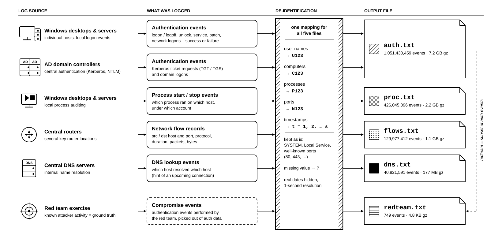
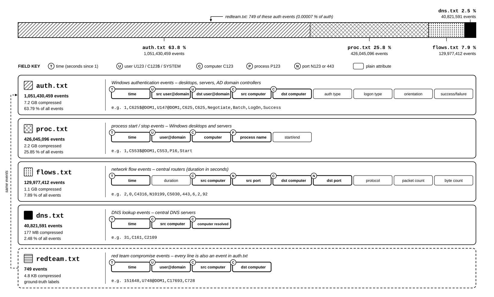
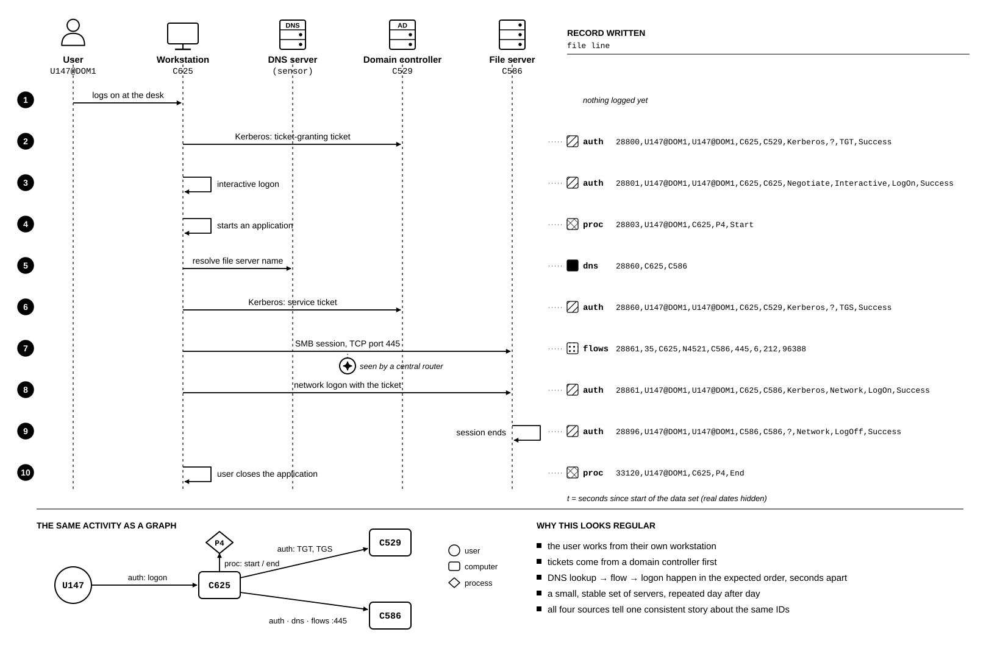
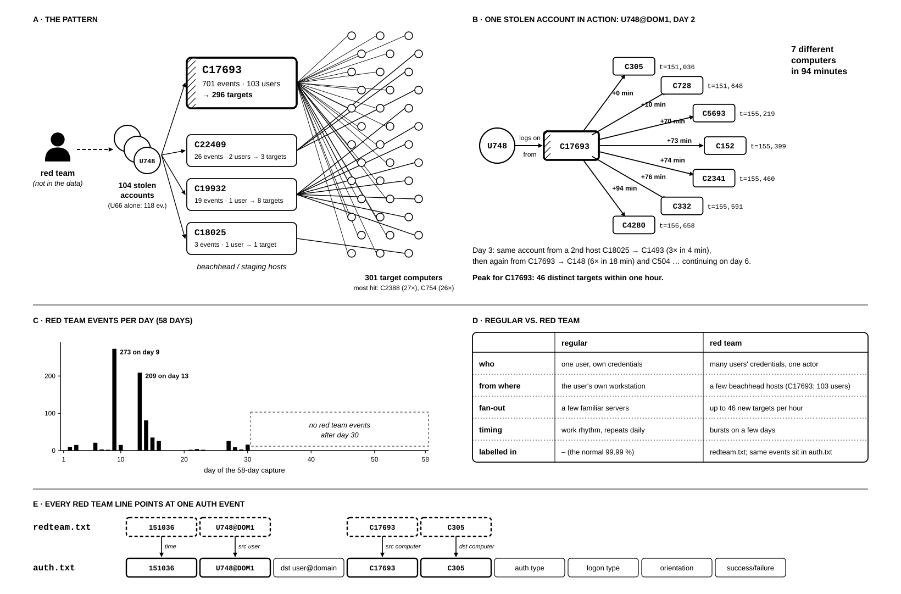

# Get Started

## Introduction

In this lab, you get to know the LANL dataset and sign in to your Autonomous AI Database. You then look at the tables that hold the events.

Estimated Time: 10 minutes

### Objectives

In this lab, you will:

- Learn how LANL captured the data and how it spreads across five files.
- Compare a regular data flow with the red team activity.
- Sign in to Database Actions as `GRAPHUSER`.
- Explore the event tables with SQL.

## About the Dataset

The dataset holds de-identified event data from the internal computer network of Los Alamos National Laboratory (LANL). LANL replaced every user, computer, process, and port with a code, and it uses the same code in every file. `U147` is the same user and `C625` the same computer wherever they appear. Well-known system accounts keep their real names, such as `SYSTEM` and `Local Service`. So do well-known ports, such as `80` and `443`. LANL also hides the real dates: time starts at `1` and counts in seconds.

### How LANL Captured the Data

LANL recorded 58 consecutive days on its internal corporate network. Five log sources fed one shared de-identification step, which produced five text files.



In total, the dataset holds 1,648,275,307 events for 12,425 users, 17,684 computers, and 62,974 processes. The compressed files take about 12 GB.

Source: A. D. Kent, *Comprehensive, Multi-Source Cyber-Security Events*, Los Alamos National Laboratory, 2015, [doi:10.17021/1179829](https://doi.org/10.17021/1179829).

### How the Events Spread Across the Five Files

Each file holds one event per line, with comma-delimited values. A question mark (`?`) marks a missing value. Every file uses the same de-identified IDs.



**Join keys across files:** `U123` is the same user and `C123` the same computer in every file. Users and computers become graph vertices, and events become edges.

Source: formats, examples, and sizes come from the [LANL dataset page](https://csr.lanl.gov/data/cyber1/). Event counts per file come from A. D. Kent, LANL 2015, and add up to 1,648,275,307.

### A Regular Data Flow: One User Opens a File Share

One everyday activity leaves matching traces in four of the five files. The values in the diagram are illustrative, but they follow the exact format of the dataset.



### Red Team Data Flows: Stolen Credentials Fanning Out from a Beachhead

The values in this diagram come from `redteam.txt`: 749 compromise events, 104 user accounts, 4 source computers, and 301 target computers, between day 2 and day 30.



Only these 749 authentication events carry a label. The process, DNS, and network flow events around them share the same hosts and minutes, but they carry no label. Finding them is the job of the graph analysis.

### Explaining List of Values

The `AUTH_TYPE` column names the authentication package that handled the event. An authentication package is the Windows component that checks the credentials and applies a security protocol.
The `LOGON_TYPE` column tells how the account logged on, for example at the keyboard or over the network.
The `AUTH_ORIENTATION` column tells which step of the authentication the event records.
The `SUCCESS_FAILURE` column tells whether the attempt succeeded.

| Table | Column | Value | Meaning |
| --- | --- | --- | --- |
| `AUTH` | `AUTH_TYPE` | `Kerberos` | The Kerberos protocol, the default in Active Directory domains. A domain controller issues the tickets. |
| `AUTH` | `AUTH_TYPE` | `NTLM` | The NTLM challenge-response protocol. Windows uses it for local accounts and when Kerberos is not possible. |
| `AUTH` | `AUTH_TYPE` | `Negotiate` | Windows picks the protocol: Kerberos first, NTLM as a fallback. The value alone does not show which protocol Windows used. |
| `AUTH` | `AUTH_TYPE` | All values that start with `MICROSOFT_` | The MSV1_0 package, full name `MICROSOFT_AUTHENTICATION_PACKAGE_V1_0`. The data also holds 13 shorter versions of this name, cut off at different lengths, from `MICROSOFT_AUTHENTICA` up to `MICROSOFT_AUTHENTICATION_PACKAGE_V1_`. All of them mean the same package. MSV1_0 checks a user name and password hash against the local account database. It passes domain logons on to a domain controller. |
| `AUTH` | `AUTH_TYPE` | `CygwinLsa`, `Setuid` | Packages from Cygwin, a Unix-like environment for Windows. Cygwin uses its own package to switch to another user account. |
| `AUTH` | `AUTH_TYPE` | `ACRONIS_RELOGON_AUTHENTICATION_PACKAGE`, `NETWARE_AUTHENTICATION_PACKAGE_V1_0`, `Wave` | Packages that third-party or legacy software adds to some hosts. |
| `AUTH` | `AUTH_TYPE` | `N` | A single letter, probably a cut-off name. |
| `AUTH` | `AUTH_TYPE` | Empty (`NULL`) | The source data has no value. The original file shows a question mark. |
| `AUTH` | `LOGON_TYPE` | `Batch` | A batch process runs on behalf of a user without direct interaction, for example a scheduled task. |
| `AUTH` | `LOGON_TYPE` | `CachedInteractive` | An interactive logon with cached credentials. The computer does not contact a domain controller. |
| `AUTH` | `LOGON_TYPE` | `Interactive` | A user logs on at the keyboard and screen of the computer. |
| `AUTH` | `LOGON_TYPE` | `Network` | A user or computer logs on to this computer from the network, for example to open a file share. |
| `AUTH` | `LOGON_TYPE` | `NetworkCleartext` | A network logon that passes the password to the authentication package in unhashed form. |
| `AUTH` | `LOGON_TYPE` | `NewCredentials` | A process copies its current identity and uses other credentials for outbound network connections, for example with `runas /netonly`. |
| `AUTH` | `LOGON_TYPE` | `RemoteInteractive` | A remote interactive session, for example over Remote Desktop. |
| `AUTH` | `LOGON_TYPE` | `Service` | The Service Control Manager starts a service under a service account. |
| `AUTH` | `LOGON_TYPE` | `Unlock` | A user unlocks the workstation. |
| `AUTH` | `LOGON_TYPE` | Empty (`NULL`) | The source data has no value. The original file shows a question mark. Kerberos ticket requests (`TGT`, `TGS`) often have no logon type. |
| `AUTH` | `AUTH_ORIENTATION` | `AuthMap` | An authentication mapping event. The LANL documentation does not describe it further. |
| `AUTH` | `AUTH_ORIENTATION` | `LogOff` | A logon session ends. |
| `AUTH` | `AUTH_ORIENTATION` | `LogOn` | An account logs on and starts a session. |
| `AUTH` | `AUTH_ORIENTATION` | `ScreenLock` | A user locks the screen. |
| `AUTH` | `AUTH_ORIENTATION` | `ScreenUnlock` | A user unlocks the screen. |
| `AUTH` | `AUTH_ORIENTATION` | `TGS` | Kerberos service ticket request. The account asks a domain controller for a ticket to one specific service, such as a file server. |
| `AUTH` | `AUTH_ORIENTATION` | `TGT` | Kerberos ticket-granting ticket request. A domain controller issues the ticket that the account then uses to request service tickets. |
| `AUTH` | `SUCCESS_FAILURE` | `Fail` | The authentication attempt failed. LANL kept failed events only for users who also have at least one successful authentication in the data. |
| `AUTH` | `SUCCESS_FAILURE` | `Success` | The authentication attempt succeeded. |

### Why NTLM Matters

NTLM is the older Windows authentication protocol. Kerberos replaced it as the default in 2000, and Microsoft deprecated NTLM in 2024. Windows still falls back to NTLM when it cannot use Kerberos, for example for local accounts.

Intruders favor NTLM because it accepts a password hash as proof of identity. An attacker who steals a hash on one computer can log on to other computers without knowing the password. This technique, called pass-the-hash, is a standard way to move from computer to computer inside a network. In the `AUTH` table, it typically shows up as a network logon: `LOGON_TYPE` holds `Network` and `AUTH_TYPE` holds `NTLM`.

An NTLM event alone does not prove an attack. Legitimate software uses NTLM every day, and a single malicious event looks like a legitimate one. The difference lies in the pattern: one source computer, many accounts, and many new targets in a short time. A graph shows this pattern directly.

The `AUTH` table in your sandbox holds 113,069,480 events:

| Authentication type | Events | Share |
| --- | ---: | ---: |
| Empty (`NULL`) | 65,611,182 | 58.0 % |
| `Kerberos` | 39,018,547 | 34.5 % |
| `NTLM` | 5,659,964 | 5.0 % |
| `Negotiate` | 2,607,146 | 2.3 % |
| All values that start with `MICROSOFT_` | 172,270 | 0.2 % |
| All other values | 371 | < 0.1 % |

A filter on `NTLM` still leaves more than 5.6 million events. That is the haystack. In the labs, you use the graph to find the needle.

### The Data in Your Sandbox

Your sandbox holds a subset of the dataset. The subset keeps the analysis fast enough for a workshop. It includes the complete `REDTEAM` file. For each of the four other files, it keeps:

- Every event from one hour before to one hour after each red team event.
- Up to 10 million events after the last red team event.

All event tables start at time `147285`, one hour before the first red team event. The figures in the diagrams above refer to the original files.

| Table | Events in your sandbox | Share of the original file | Time range | Days of the capture |
| --- | ---: | ---: | --- | --- |
| `AUTH` | 113,069,480 | 10.8 % | 147285 to 2608208 | 2 to 31 |
| `PROC` | 59,920,991 | 14.1 % | 147285 to 2676817 | 2 to 31 |
| `FLOWS` | 31,611,295 | 24.3 % | 147285 to 3126928 | 2 to 37 |
| `DNS` | 11,554,412 | 28.3 % | 147285 to 3308396 | 2 to 39 |
| `REDTEAM` | 749 | 100 % | 150885 to 2557047 | 2 to 30 |

The `ID` column numbers the lines of the original file. An empty value (`NULL`) replaces the question mark. The `AUTH` table also has a `REDTEAM` column. It holds `1` for each authentication event that matches a line in `REDTEAM`, and `0` for all other events.

## Task 1: Connect to the Autonomous AI Database

1. On your reservation page, click **View Login Info**. Copy the **Database Actions URL**, the database user `GRAPHUSER`, and its password.

2. Open the Database Actions URL in a new browser tab and sign in as `GRAPHUSER`.

    The Database Actions Launchpad opens.

## Task 2: Explore the Dataset

1. On the Launchpad, click **SQL**. A SQL worksheet opens.

2. Check the size of each table. Paste the query into the worksheet and click **Run Script**.

    ```sql
    <copy>
    -- -------------GET STARTED TASK 2 STEP 2-------------
    SELECT table_name, num_rows
    FROM user_tables
    WHERE table_name IN ('AUTH', 'DNS', 'FLOWS', 'PROC', 'REDTEAM',
                         'COMPUTER', 'USER_DOMAIN', 'PROCESS')
    ORDER BY num_rows DESC;
    </copy>
    ```

    `AUTH` is the largest table and `REDTEAM` the smallest. `COMPUTER`, `USER_DOMAIN`, and `PROCESS` list the distinct computers, accounts, and processes from the event tables.

3. Find the beachhead computers. This query groups the red team events by the computer they started from.

    ```sql
    <copy>
    -- -------------GET STARTED TASK 2 STEP 3-------------
    SELECT src_computer,
           COUNT(*)                     AS events,
           COUNT(DISTINCT user_domain)  AS accounts,
           COUNT(DISTINCT dst_computer) AS targets
    FROM redteam
    GROUP BY src_computer
    ORDER BY events DESC;
    </copy>
    ```

    The query returns four computers. `C17693` leads by far, as the red team diagram shows.

4. Match the first red team events to their authentication events. Each `REDTEAM` row points at one `AUTH` row with the same time, account, source computer, and destination computer.

    ```sql
    <copy>
    -- -------------GET STARTED TASK 2 STEP 4-------------
    SELECT r.time, r.user_domain, r.src_computer, r.dst_computer,
           a.auth_type, a.logon_type, a.auth_orientation,
           a.success_failure, a.redteam
    FROM redteam r
    JOIN auth a
      ON  a.time            = r.time
      AND a.src_user_domain = r.user_domain
      AND a.src_computer    = r.src_computer
      AND a.dst_computer    = r.dst_computer
    ORDER BY r.time
    FETCH FIRST 5 ROWS ONLY;
    </copy>
    ```

    The `AUTH` columns add what `REDTEAM` leaves out, such as the authentication type and the outcome. The `REDTEAM` column holds `1` in every row.

## Learn More

- [LANL Comprehensive, Multi-Source Cyber-Security Events dataset](https://csr.lanl.gov/data/cyber1/)
- [NTLM overview (Microsoft)](https://learn.microsoft.com/windows-server/security/kerberos/ntlm-overview)
- [Pass the Hash, technique T1550.002 (MITRE ATT&CK)](https://attack.mitre.org/techniques/T1550/002/)
- [Successful Local Account Login, analytic CAR-2016-04-004 (MITRE CAR)](https://car.mitre.org/analytics/CAR-2016-04-004/)

## Acknowledgements

* **Author** - Karin Patenge, Database Product Management
* **Contributors** - Hans Viehmann, Léo Nicolle (Linkurious), Ramu Murakami Gutierrez
* **Last Updated By/Date** - Karin Patenge, December 2026
